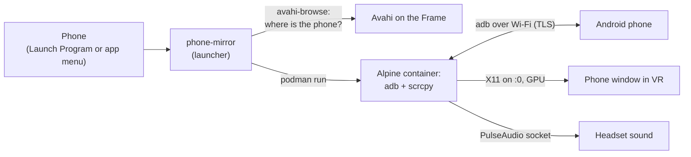

# Steam Frame phone mirror

See and use your Android phone inside the Valve Steam Frame, without taking the
headset off. Open **Phone** from the VR dashboard and your phone's screen
appears as a window: read a message, answer a chat, or use any app with the
laser pointer. Type with the SteamVR keyboard or by voice. The phone's sound
plays in the headset.

It runs [scrcpy](https://github.com/Genymobile/scrcpy) over Wi-Fi, set up for
the Frame. scrcpy isn't in SteamOS's package repos or on Flathub, so it runs in
a small podman container built from Alpine Linux's packages. The project adds
the glue the Frame needs: the headset's display, GPU and sound in the
container, finding the phone on the network, and a menu entry the dashboard
lists.

- No root, no `steamos-readonly disable`: everything lives in your home directory
  and survives SteamOS updates.
- Nothing to install on the phone: it uses Android's built-in Wireless debugging.
- One command to install, one to pair, one to remove.

## What you need

- A Steam Frame, with a shell on it as the `steamos` user (see below).
- An Android phone with Android 11 or newer (that's when Wireless debugging and
  sound capture arrived).
- The Frame and the phone on the same Wi-Fi network. The network has to let
  devices find each other (mDNS). Some guest and office networks block that.
- About 800 MB of free space.

## Install

You need a shell on the Frame as the `steamos` user:

- **In the headset:** open **Desktop** (dashboard → **+** → Launch Program →
  Desktop), then **Konsole** from the app menu.
- **Or over SSH**, if you've set it up (for example with
  [Frame Control](https://github.com/saphid/frame-control)): `ssh steamos@<your-frame>`.

Then run:

```bash
curl -fsSL https://raw.githubusercontent.com/mswietlicki/steam-frame-phone-mirror/main/install.sh | bash
```

Or clone it and run the script (git is on the Frame):

```bash
git clone https://github.com/mswietlicki/steam-frame-phone-mirror.git
cd steam-frame-phone-mirror
./install.sh
```

The first install builds the container image, which takes a minute or two. It
then adds **Phone** to the desktop's app menu and to the dashboard's
**+** → Launch Program menu.

## Pair your phone (once)

This is easiest with the headset off and the phone in your hand, over SSH from
a computer. You need to read a code off the phone.

1. On the phone, turn on Developer options: Settings → About phone → tap
   **Build number** seven times. (On some phones it's under About phone →
   Software information.)
2. Settings → System → Developer options → **Wireless debugging**: turn it on,
   and allow it on this network.
3. Tap **Pair device with pairing code**, and keep that screen open.
4. On the Frame, run:

   ```bash
   ~/.local/bin/phone-mirror pair
   ```

   Or from a computer: `ssh -t steamos@<your-frame> '~/.local/bin/phone-mirror pair'`.

It waits up to a minute for the pairing screen to show up on the network. If it
doesn't find it, type the "IP address & port" shown under the code. Then type
the 6-digit code. It ends with a line like
`connected: 192.168.1.23:37011, <your phone>, Android 15`.

The pairing is kept. You don't pair again unless you remove the Frame on the
phone or uninstall with `--purge`.

## Use it

1. Wireless debugging must be on. Android turns it off when the phone moves to
   another Wi-Fi network. Tip: Developer options → Quick settings developer
   tiles → **Wireless debugging** adds a tile to the phone's quick settings.
2. Unlock the phone (see [Known issues](#known-issues)).
3. In the headset: dashboard → **+** → Launch Program → **Phone**. Or use
   **Phone** in the desktop's app menu.

The phone's own screen turns off while it's mirrored, and its sound plays in
the headset. Point and click with the laser. Type with the SteamVR keyboard, or
by voice with [steam-frame-dictation](https://github.com/mswietlicki/steam-frame-dictation).
Close the window to stop.

From a shell, `~/.local/bin/phone-mirror` opens it on the headset's display.

| Command | What it does |
|---|---|
| `./install.sh` | Install, or update after `git pull` |
| `./install.sh install --update` | Rebuild with the newest scrcpy and Alpine packages |
| `./install.sh pair` | Pair a phone |
| `./install.sh status` | Image, versions, pairing, whether the Frame sees and reaches the phone |
| `./install.sh uninstall` | Remove it (keeps the pairing and your options) |
| `./install.sh uninstall --purge` | Remove everything |

(With the curl one-liner, add the command after `bash -s --`, e.g.
`curl -fsSL …/install.sh | bash -s -- uninstall`. Pairing needs a terminal, so
use `~/.local/bin/phone-mirror pair` for that.)

## Options

`~/.config/phone-mirror/options` holds the scrcpy options Phone starts with,
one per line ([`files/options`](files/options); `scrcpy --help` lists them all).
The defaults:

- `--max-size=1280` and `--max-fps=30`: decoding the video takes CPU from games,
  and VR windows render at 1280×720 anyway. `--max-fps=60` scrolls more smoothly.
- `--turn-screen-off`: the phone's own screen stays dark while mirrored.

Others worth knowing: `--no-audio` keeps the sound on the phone. `--stay-awake`
stops the phone from sleeping (and locking) while mirrored, but only while it's
charging. Arguments to `~/.local/bin/phone-mirror` come after the file's.
Reinstalling keeps your edits.

## How it works



1. **The container.** [`files/Containerfile`](files/Containerfile) installs
   Alpine's scrcpy and adb, plus what SDL 3 loads at run time: X11 libraries,
   Mesa (its freedreno driver runs the Frame's Adreno GPU) and libpulse. It's a
   rootless podman image, built on the Frame.
2. **The window.** [`files/phone-mirror`](files/phone-mirror) starts the
   container with gamescope's X socket. Started from Launch Program, that's
   display `:0`, so the window opens as its own VR window. `/dev/dri` gives it
   the GPU. `--pid host` gives the window its real process id, and
   `--ipc host` lets X11 use shared memory. Sound goes to PipeWire through its
   PulseAudio socket.
3. **Finding the phone.** Alpine's adb has no working mDNS: it never opens
   port 5353. So the launcher asks the Frame's own Avahi
   (`avahi-browse _adb-tls-connect._tcp`, or `_adb-tls-pairing._tcp` while
   pairing) and passes the address in. adb then connects, skipping the
   `emulator-*` devices it makes of the Frame's Android-app (Lepton)
   containers.
4. **D-Bus.** Rootless podman creates its cgroups through systemd on the
   session bus. The headset desktop has a bus of its own without systemd. A
   podman started from there fails with
   `crun: sd-bus call: … Input/output error`. So the launcher and the installer
   point podman at the user bus, `/run/user/1000/bus`.

Measured on a Frame: scrcpy takes about 8% of one CPU core while the phone's
screen is still, and about 20% while you use it (30 fps). adb takes 2%.

## What it installs

All in your home directory:

| Path | What |
|---|---|
| podman image `localhost/phone-mirror`, and its base `alpine:3.24` | scrcpy, adb, Mesa, X11 and PulseAudio libraries; about 800 MB |
| `~/.local/bin/phone-mirror` | The launcher |
| `~/.local/share/applications/phone-mirror.desktop` | The **Phone** menu entry (the dashboard lists it too) |
| `~/.config/phone-mirror/options` | Your scrcpy options |
| `~/.local/share/phone-mirror/` | `inside.sh` (runs in the container), `home/` (adb's key, which is the pairing, and Mesa's shader cache), `last.log` (the last run's output) |

## Security

Wireless debugging gives a paired computer the same control of the phone as USB
debugging: it can see the screen, install apps and read files. Here that
computer is the Frame. The key paired with your phone is
`~/.local/share/phone-mirror/home/.android/adbkey`, so anyone with a shell on
your Frame (SSH included) can use your phone while Wireless debugging is on.
Turn Wireless debugging off when you don't need it. When you stop using this,
remove the Frame on the phone: Wireless debugging → Paired devices.

## Known issues

- **A locked phone can't be unlocked from the headset.** Phone connects and
  shows the lock screen, but unlocking from there didn't work (tested on
  Android 15). Unlock the phone before you put the headset on. A longer screen
  timeout on the phone helps, and so does `--stay-awake` while it's charging.
- **Apps that block screenshots show black:** banking apps, some password
  managers, protected video.
- **No notifications inside VR games.** Open the dashboard to look at Phone.
- **The window is 1920×1080** (gamescope's size), so the tall phone screen sits
  in the middle with black bars.
- **One phone at a time:** Phone uses the first paired phone that answers.
- **Tested on one Frame:** SteamOS 0.5.6 (build 20261015), scrcpy 4.0, adb
  35.0.2, Alpine 3.24, with a Ulefone Armor 29 Pro on Android 15.

## Troubleshooting

```bash
./install.sh status                          # image, pairing, can the Frame see and reach the phone?
cat ~/.local/share/phone-mirror/last.log     # output of the last run
avahi-browse -rt _adb-tls-connect._tcp       # is the phone's Wireless debugging visible on the network?
```

- **"Phone not found":** Wireless debugging is off, the phone is on another
  network, or the network blocks mDNS. `avahi-browse` should list the phone.
- **`connected: none` although the phone is listed:** the phone isn't paired
  with this Frame (or the pairing was removed on the phone). Pair again.
- **The window is black:** the app on the phone blocks screen capture.

## Credits

- [scrcpy](https://github.com/Genymobile/scrcpy) by Genymobile (Apache 2.0)
  does all the mirroring. This project only packages and starts it.
- [Alpine Linux](https://alpinelinux.org)'s scrcpy, android-tools and Mesa
  packages.
- [Frame Control](https://github.com/saphid/frame-control) (MIT), whose docs on
  the Frame's internals helped.

Not affiliated with Valve or Genymobile.

## License

[MIT](LICENSE)
